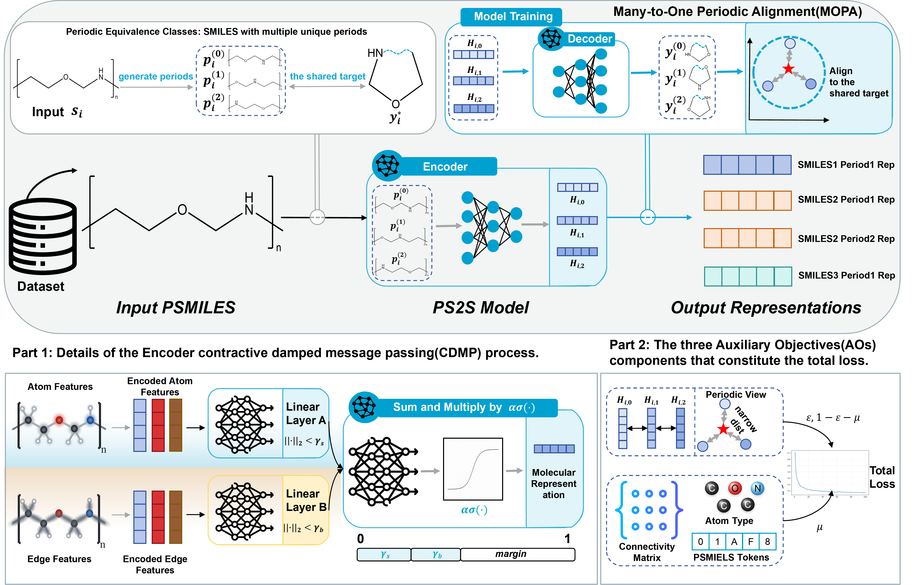

# PS2S

**Task Example**: We propose PS2S(Periodic Structure-to-Semantics, a self-supervised representation learning framework for linear homopolymers. PS2S aims to lift the learning target from a single PSMILES to structural semantic learning over periodic equivalence classes. PS2S constructs multiple periodically equivalent views of the same polymer and aligns them to a shared canonical periodic target, thereby encouraging the model to learn common structural identity across views rather than memorize a particular finite notation.

```
 Three important characteristics:
 1) Many-to-One Periodic Alignment(MOPA): PS2S aligns all equivalent views to a shared canonical target, lifting supervision to the equivalence-class level and turning periodic equivalence into a signal for learning invariant polymer representations.;
 2) Auxiliary Objectives(AOs): PS2S introduce two auxiliary objectives, structure restoration and representation consistency, to preserve local fidelity and stabilize the latent space..
 3) Contractive Damped Message Passing(CDMP): to model long-range periodicity, PS2S seek a stable representation that is independent of a preset receptive-field range, approximating periodic-boundary propagation through a self-consistent update on a finite periodic graph.
```

# Approach



Overview of our method. Top: A shared encoder maps periodically equivalent PSMILES views to latent representations, while a decoder reconstructs a shared canonical periodic target, promoting representation consistency. Bottom left: The encoder employs contractive damped message passing with symmetrically normalized bond adjacency, $tanh$ activation, and spectral-norm bounds satisfying $\gamma_s+\gamma_b<1$, ensuring convergence to a unique fixed point for each input graph. Bottom right: Pretraining combines representation consistency, periodic alignment, and structure restoration losses. Structure restoration reconstructs graph connectivity, atom types, and PSMILES tokens to preserve structural information.


# prepare the datasets
1. The BMD and NOOP2025 dataset are under  the `dataset/` directory:

```
root/
├── dataset/
│ └── BMD/
│ └── NOOP2025/
└── data/
```

2. About pretrained datas, you can find under the `dataset/` directory:

```
root/
├── dataset/
│ └── pretrain_data.csv/
└── data/
```

# Dependencies
we recommend installing the following packages:

```
rdkit == 2026.3.1
python == 3.11
torch == 2.3.0
torchvision == 0.18.0
numpy == 2.4.6
tqdm == 4.67.3
torch_geometric == 2.7.0
torch-scatter == 2.1.2
transformers == 4.38.2
torch-spline-conv == 1.2.1
```

# Representations

```
root/
├── EncoderFeatures/
│ └── get_different_atom_feature_of_smiles.py/
│ └── get_different_features_of_smiles.py/
└── 
```

You can get representations in the `EncoderFeatures/` directory. Through `get_different_atom_feature_of_smiles.py` you can get atom-level representations, and through `get_different_features_of_smiles.py` you can get molecule-level representations.

# Models

```
root/
├── ps2s/
└── 
```

You can get the detail of ps2s model under the `ps2s/` directory.

# Generation

```
root/
├── PolymerGenerationPretrainedModelTrain/
└──
```

You can get the detail of generation task under the PolymerGenerationPretrainedModelTrain/` directory.
